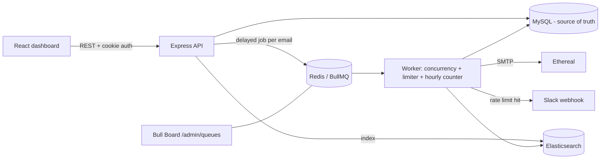

# ReachInbox Email Scheduler

Production-style email scheduler + dashboard: **Express + TypeScript, BullMQ/Redis, MySQL, Elasticsearch, Ethereal SMTP, React + Tailwind**, with real Google login and Slack OAuth.

```
backend/   Express API, BullMQ worker, rate limiter, Slack, Elasticsearch, Bull Board
frontend/  React + Vite + Tailwind dashboard
```

## Quick start (local)

Prereqs: Node 20+, Docker.

```bash
docker compose up -d                         # Redis (AOF on), MySQL, Elasticsearch
cd backend && cp .env.example .env           # fill in Google (+ Slack) credentials, see below
npm install && npm run dev                   # API + worker on :4000
# new terminal
cd frontend && npm install && npm run dev    # dashboard on http://localhost:5173
```

Open http://localhost:5173 -> **Continue with Google**.
Live queue dashboard: http://localhost:4000/admin/queues (basic auth `BULL_BOARD_USER` / `BULL_BOARD_PASS`, default `admin`/`admin`).
Health: `GET /health`. A sample lead list is in `leads.sample.csv`.

Run API and worker as separate processes: `RUN_WORKER=false npm start` (API only) and `npm run worker` (worker only).

### Environment variables (`backend/.env.example`)

| Var | Purpose |
|---|---|
| `APP_URL` / `FRONTEND_URL` | Public backend URL (OAuth redirects) / where the React app lives |
| `REDIS_URL`, `DATABASE_URL`, `ELASTICSEARCH_URL` | Infra connections (`DATABASE_SSL=true` for managed MySQL; `ELASTICSEARCH_API_KEY` for Elastic Cloud) |
| `GOOGLE_CLIENT_ID/SECRET` | Google OAuth. Redirect URI: `{APP_URL}/api/auth/google/callback` |
| `SLACK_CLIENT_ID/SECRET` | Slack app with scope `incoming-webhook`. Redirect URL: `{APP_URL}/api/slack/callback` |
| `WORKER_CONCURRENCY` | Parallel jobs per worker (default 5) |
| `MIN_DELAY_BETWEEN_SENDS_MS` | Minimum gap between individual sends (default **2000 ms**) |
| `DEFAULT_EMAILS_PER_HOUR_PER_SENDER` / `MAX_EMAILS_PER_HOUR_PER_SENDER` | Default and hard cap for the hourly limit (50 / 200) |
| `SENDERS_PER_USER` | Number of Ethereal sender accounts per user (default 3) |

### Ethereal (fake SMTP) setup
Nothing to do manually: on a user's first schedule the backend calls `nodemailer.createTestAccount()` and stores `SENDERS_PER_USER` Ethereal accounts in the `senders` table. Every sent email gets a **preview URL** (shown in the *Sent Emails* table) so you can open the delivered message. To use your own account, create one at https://ethereal.email/create and insert it into `senders`.

### Google OAuth setup
Google Cloud Console -> APIs & Services -> Credentials -> *OAuth client ID* (Web). Add the redirect URI above (and `http://localhost:4000/api/auth/google/callback` for local). Configure the consent screen and add yourself/reviewers as test users.

### Slack OAuth setup
api.slack.com/apps -> Create app -> *OAuth & Permissions*: add redirect URL, add scope `incoming-webhook`, enable Incoming Webhooks. In the dashboard click **Connect Slack**, pick a channel; the webhook URL is stored per user. If Slack rejects an `http://localhost` redirect, use your deployed HTTPS URL or a tunnel (e.g. `cloudflared tunnel --url http://localhost:4000`) as `APP_URL`.

## Architecture



### How scheduling works
`POST /api/emails/schedule` validates + de-duplicates recipients, writes a batch and one `emails` row per recipient (email *i* is due at `start + i * delay`, assigned round-robin to the user's senders), then adds one **BullMQ delayed job per email** with `jobId = email-<id>`. No cron of any kind - BullMQ's delayed set in Redis fires the job at the right time.

### Persistence & restart safety
- Jobs live in Redis (AOF enabled in `docker-compose.yml`); email state lives in MySQL. Stop the server, start it again: delayed jobs are still in Redis and fire on time. Nothing restarts from scratch.
- **Startup reconcile (not a cron):** on boot every DB row still `scheduled/sending` is checked against BullMQ; missing jobs (e.g. Redis was wiped) are re-added. Deterministic job ids make this idempotent.
- Graceful shutdown waits for in-flight jobs; anything unfinished stays queued.

### Idempotency (no double sends)
1. Deterministic `jobId` -> BullMQ ignores duplicate enqueues.
2. Worker skips emails already `sent`/`failed`.
3. Atomic DB claim (`UPDATE ... WHERE status='scheduled'`) so only one worker owns an email; a stale claim (>60 s, crashed worker) can be re-claimed.

### Concurrency
`WORKER_CONCURRENCY` jobs run in parallel per worker; safety comes from the atomic claim and the Redis-atomic rate-limit counter, so multiple workers/instances are safe.

### Delay between sends
BullMQ worker **limiter** `{ max: 1, duration: MIN_DELAY_BETWEEN_SENDS_MS }` - a Redis-backed throttle shared by all workers. **Chosen: min 2 seconds between sends** (configurable). The per-campaign "delay between emails" in the UI sets the scheduled spacing on top of this floor.

### Hourly rate limit
Per **sender**, per hour window. A Lua script atomically `INCR`s `rl:sender:<id>:<hourWindow>` and refuses (and rolls back) when over the limit - safe across workers/instances. Limit = value chosen in the UI, clamped to `MAX_EMAILS_PER_HOUR_PER_SENDER`.
When the limit is hit the job is **never dropped or failed**: it is moved (`moveToDelayed`) to the start of the next hour window plus a small stagger by its original position, which preserves order. Failed SMTP sends release their slot, so failures don't burn quota.
**Slack:** the first hit per sender per window triggers a real Slack webhook call to the user's connected channel (deduped with a Redis `SET NX`, so 1000 blocked jobs = 1 message). No Slack connected -> silently skipped; connecting later works immediately, no redeploy.

### Behavior under load (1000+ emails at the same time)
All 1000 jobs become due together; the worker limiter drains them at one send per `MIN_DELAY` (max concurrency respected); per sender only `limit` emails go out in the current hour, the rest are pushed to the next window(s) in order; nothing is lost. Only a few jobs run at once, so memory stays flat.

### Search
Every schedule/send/status change is indexed in Elasticsearch (`emails` index; fuzzy multi-match + wildcard on address). `GET /api/emails?q=...` uses it and transparently falls back to SQL `LIKE` if Elasticsearch is down.

## Feature map
**Backend:** scheduler (delayed jobs) · persistence + startup reconcile · idempotency · configurable concurrency · min delay between sends · per-sender hourly limit (Redis) · Slack OAuth + live rate-limit alerts · Elasticsearch search (SQL fallback) · Bull Board (`/admin/queues`) · Google OAuth + email/password auth (JWT cookie) · multiple Ethereal senders (pick one or rotate) · rich-text bodies sanitized server-side · health check.
**Frontend (built from the Figma frames):**
- **Login** - Login with Google, or email + password (signs the user up if the email is new).
- **Sidebar** - user card (avatar, name, email, logout menu), Compose, Scheduled / Sent with live counts, Slack connect/test/disconnect, link to the queue dashboard.
- **Scheduled / Sent lists** - rows with orange scheduled-time pill or Sent/Failed pill, subject + body preview, star, search (Elasticsearch), filter, refresh, pagination, loading / empty / error states, 5 s live updates.
- **Email detail** - sender, recipient, time, rendered body, status, link to the delivered Ethereal message.
- **Compose** - From selector, recipient chips (type, paste or **Upload List** CSV/text with detected-count), subject, delay between emails, hourly limit, rich-text editor, **Send Later** popover (date/time + quick picks).

## API
`POST /api/auth/email` · `GET /api/auth/google` · `GET /api/auth/me` · `POST /api/auth/logout` · `GET /api/senders` · `POST /api/emails/schedule` · `GET /api/emails?status=scheduled|sent&state=&q=&page=` · `GET /api/emails/stats` · `GET /api/emails/:id` · `GET /api/slack/{status,connect,callback}` · `POST /api/slack/test` · `DELETE /api/slack`

## Tests
`cd backend && npm run e2e` (needs local Redis + MySQL; uses a local SMTP sink). Verifies: hourly limit -> reschedule (not drop), throttle, restart/Redis-loss recovery, exactly-once delivery, validation.

## Running & hosting
Step-by-step instructions (installs, Google/Slack setup, public URL, demo script, submission) are in **[SETUP_GUIDE.md](SETUP_GUIDE.md)**.

The `Dockerfile` builds API + worker + React app into one image served from one origin (cookies and OAuth redirects just work). Without Docker: `npm run install:all && npm run build && npm start` serves everything on port 4000.

> **Hosting note:** free tiers of some PaaS providers (e.g. Render free web services) block outbound SMTP ports 25/465/587, which Ethereal needs. Use a host that allows outbound 587 (a VM, or your own machine behind an HTTPS tunnel such as ngrok).

**Load demo:** `npm run leads` writes `leads-1000.csv`; upload it in Compose with a low hourly limit to watch the limiter, rescheduling and Slack alert in action (queue visible at `/admin/queues`).

## Assumptions, shortcuts & trade-offs
- Delivery is **at-least-once**: a crash in the few ms between SMTP acceptance and the DB update could re-send one email. Fixing this fully needs provider-side idempotency keys, which Ethereal doesn't offer.
- Order is preserved "as much as possible": rate-limited jobs are staggered by original position (capped at 60 s).
- Recipients are limited to 5000 per schedule request; leads are parsed from any email-shaped text in the uploaded file.
- SMTP passwords for the fake Ethereal accounts are stored in plain text (they are disposable test credentials); real credentials would need encryption at rest.
- Email bodies are rich-text HTML from a `contentEditable` editor (`document.execCommand`, deprecated but universally supported), sanitized with an allow-list on the server; no templating/merge tags.
- The Figma's attachment button is not implemented (not in the written requirements). A few editor icons are approximations of the Figma glyphs.
- Email/password login has no rate limiting or email verification (Google login is the primary flow).
